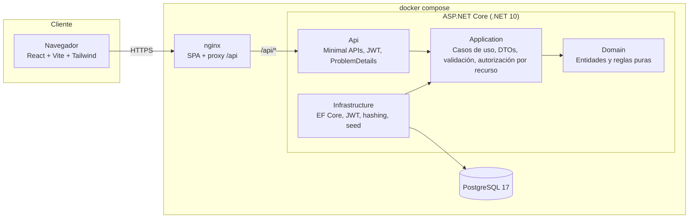

# Sistema Académico

[](https://github.com/angel-cm-dev/sistema-academico/actions/workflows/ci.yml)


Sistema de gestión académica para un colegio peruano: **alumnos y apoderados, grados y secciones, cursos y docentes, matrícula con control de vacantes, notas por competencia con promedio ponderado en escala vigesimal, asistencia, pensiones con mora y libreta de notas imprimible**.

Es un proyecto full-stack de portafolio construido con **ASP.NET Core (.NET 10) + EF Core + PostgreSQL** en el backend y **React 18 + Vite + TypeScript + Tailwind** en el frontend, organizado con Clean Architecture y con pruebas automatizadas en ambas capas.

> Todos los datos de demostración (nombres, DNI, teléfonos) son **ficticios**.

---

## Tabla de contenido

- [Características](#características)
- [Arquitectura](#arquitectura)
- [Stack y justificación](#stack-y-justificación)
- [Inicio rápido con Docker](#inicio-rápido-con-docker)
- [Ejecución sin Docker](#ejecución-sin-docker)
- [Credenciales demo](#credenciales-demo)
- [Endpoints principales](#endpoints-principales)
- [Reglas de negocio](#reglas-de-negocio)
- [Pruebas](#pruebas)
- [Estructura de carpetas](#estructura-de-carpetas)
- [Variables de entorno](#variables-de-entorno)
- [Qué aprenderás con este proyecto](#qué-aprenderás-con-este-proyecto)
- [Roadmap](#roadmap)
- [Licencia y autor](#licencia-y-autor)

---

## Características

| Módulo | Qué hace |
|---|---|
| **Autenticación** | Login con JWT, contraseñas con PBKDF2 (PasswordHasher de ASP.NET Identity), límite de intentos de login por IP. |
| **Roles** | `Admin` (todo), `Docente` (solo sus cursos y secciones), `Apoderado` (solo sus hijos). La **autorización por recurso se aplica en el backend**, no solo ocultando botones. |
| **Alumnos y apoderados** | CRUD con validación de DNI peruano (8 dígitos), búsqueda, filtros, orden y paginación; baja lógica para conservar historial. |
| **Grados, secciones y cursos** | Secciones por periodo con capacidad (vacantes); cursos con competencias y **pesos configurables**. |
| **Matrícula** | Una matrícula por alumno y periodo, **validación de vacantes con concurrencia optimista** y generación automática del cronograma de pensiones. |
| **Notas** | Registro por competencia y bimestre (0-20), **promedio ponderado** y redondeo vigesimal (10.5 → 11), equivalencia literal AD/A/B/C. |
| **Asistencia** | Registro diario por sección (presente, tardanza, falta, falta justificada), porcentaje y alerta de riesgo (< 70 %). |
| **Pensiones** | Cronograma marzo-diciembre, estado por fecha, **mora diaria con días de gracia y tope**, registro de pagos con mora congelada. |
| **Libreta** | Vista **imprimible** (A4, sin colores del tema oscuro) con notas, promedios, asistencia y situación final. |
| **Dashboard** | KPIs según el rol: ocupación de aulas, recaudación, deuda vencida, asistencia, carga docente. |
| **Calidad** | ProblemDetails (RFC 9457), logging estructurado JSON (Serilog), OpenAPI + Scalar, `/health`, CI en GitHub Actions. |
| **Frontend** | Login, layout con sidebar responsive, modo oscuro, tablas con búsqueda/filtros/paginación, formularios validados (zod), estados de carga/vacío/error. |

## Arquitectura



Las dependencias apuntan **hacia adentro**: `Domain` no conoce a nadie; `Application` solo conoce a `Domain` y las abstracciones; `Infrastructure` implementa esas abstracciones; `Api` compone todo. El detalle está en [`docs/arquitectura.md`](docs/arquitectura.md).

## Stack y justificación

| Capa | Tecnología | Por qué |
|---|---|---|
| Runtime | **.NET 10** (`net10.0`) | Versión LTS actual; el proyecto solo requiere el SDK 10 (no necesita el runtime 8). |
| API | ASP.NET Core **Minimal APIs** | Menos ceremonia que controladores, agrupación por recurso (`MapGroup`) y filtros de endpoint para validación. |
| ORM | **EF Core 10** + Npgsql | Migraciones versionadas, LINQ tipado; el proveedor se elige por configuración (PostgreSQL o SQLite). |
| BD | **PostgreSQL 17** | Robusta, gratuita, con `numeric` exacto para dinero y notas y restricciones `CHECK`. |
| Validación | **FluentValidation** | Reglas expresivas y testeables, separadas de los DTOs. |
| Seguridad | JWT Bearer + PasswordHasher (PBKDF2) | Estándar sin estado; hashing con sal e iteraciones y formato versionado. |
| Logging | **Serilog** (JSON compacto) | Logs estructurados listos para Loki/ELK/Seq. |
| Docs API | **OpenAPI** nativo + **Scalar** | Documento OpenAPI generado por el framework y una UI moderna para probar endpoints con token. |
| Pruebas backend | **xUnit** + **WebApplicationFactory** + SQLite en memoria | Pruebas de integración reales (HTTP → BD) **sin Docker**. |
| Frontend | **React 18 + Vite + TypeScript** | Ecosistema maduro, build rápido y tipado de punta a punta. |
| Estilos | **Tailwind CSS 3** | Diseño consistente, modo oscuro por clase y variantes `print:` para la libreta. |
| Formularios | **react-hook-form + zod** | Validación declarativa con mensajes por campo, misma regla que el backend. |
| Pruebas frontend | **Vitest + Testing Library** | Rápidas y centradas en el comportamiento que ve el usuario. |

## Inicio rápido con Docker

Requisitos: Docker Desktop (o Docker Engine + Compose v2).

```bash
git clone https://github.com/angel-cm-dev/sistema-academico.git
cd sistema-academico
cp .env.example .env          # edita POSTGRES_PASSWORD y JWT_KEY
docker compose up --build     # un solo comando
```

| Servicio | URL |
|---|---|
| Aplicación web | http://localhost:8080 |
| API + documentación (Scalar) | http://localhost:5080/scalar/v1 |
| OpenAPI JSON | http://localhost:5080/openapi/v1.json |
| Health check | http://localhost:5080/health |

Al iniciar, la API aplica las **migraciones** de EF Core y carga los **datos demo** (si `SEED_DEMO=true`).

## Ejecución sin Docker

### Backend

Requisito: [.NET SDK 10](https://dotnet.microsoft.com/download). En el entorno `Development` la API usa **SQLite** (archivo local `sistema-academico-dev.db`), así que no necesitas instalar PostgreSQL para probarla.

```bash
cd backend
dotnet run --project src/SistemaAcademico.Api --launch-profile http
# API en http://localhost:5080  ·  Scalar en http://localhost:5080/scalar/v1
```

¿Quieres usar PostgreSQL local? Sobrescribe la configuración con variables de entorno:

```bash
# PowerShell
$env:Database__Provider="Postgres"
$env:ConnectionStrings__Default="Host=localhost;Database=sistema_academico;Username=postgres;Password=tu-clave"
dotnet run --project src/SistemaAcademico.Api --launch-profile http
```

Crear una nueva migración (herramienta local incluida en `backend/dotnet-tools.json`):

```bash
cd backend
dotnet tool restore
dotnet ef migrations add NombreMigracion --project src/SistemaAcademico.Infrastructure --output-dir Persistence/Migrations
```

### Frontend

Requisito: Node.js 20+ (probado con Node 24 / npm 11).

```bash
cd frontend
npm install
npm run dev        # http://localhost:5173 (Vite reenvía /api a http://localhost:5080)
```

Si tu API corre en otro puerto: `VITE_API_PROXY=http://localhost:5000 npm run dev`.

## Credenciales demo

Contraseña para todos: **`Demo123!`**

| Rol | Correo | Qué puede hacer |
|---|---|---|
| Admin | `admin@demo.pe` | Todo: alumnos, matrícula, secciones, pesos, pagos, libretas. |
| Docente | `docente@demo.pe` | Rosa Quispe (Matemática): notas y asistencia **solo de sus cursos/secciones**. |
| Docente | `docente2@demo.pe` | Jorge Salazar (Comunicación): útil para comprobar que no puede tocar Matemática. |
| Apoderado | `apoderado@demo.pe` | Carlos Mendoza: ve **solo a sus 2 hijos**, sus libretas y pensiones. |
| Apoderado | `apoderado2@demo.pe` | María Flores: otro apoderado para probar el aislamiento de datos. |

## Endpoints principales

Todos bajo `/api`, protegidos con JWT salvo el login. Más ejemplos en [`docs/guia-api.md`](docs/guia-api.md).

| Método | Ruta | Rol | Descripción |
|---|---|---|---|
| POST | `/auth/login` | público | Devuelve el token JWT. |
| GET | `/auth/me` | autenticado | Usuario actual. |
| GET | `/dashboard` | autenticado | KPIs según el rol. |
| GET/POST | `/usuarios` | Admin | Gestión de cuentas. |
| GET | `/alumnos?search=&activo=&page=&pageSize=&sortBy=&sortDir=` | todos (filtrado) | Listado paginado. |
| POST/PUT/DELETE | `/alumnos[/{id}]` | Admin | Alta, edición y baja lógica. |
| GET/POST | `/apoderados`, `/docentes` | Admin | Listados paginados y altas. |
| GET/POST | `/periodos`, `/grados`, `/secciones` | lectura: todos · escritura: Admin | Estructura académica. |
| GET | `/cursos` | Admin, Docente | Cursos con competencias y pesos. |
| PUT | `/cursos/{id}/competencias` | Admin | Configura pesos del promedio ponderado. |
| GET/POST | `/asignaciones` | Admin (Docente: solo lectura de las suyas) | Docente ↔ curso ↔ sección. |
| GET/POST | `/matriculas` | lectura: todos (filtrado) · alta: Admin | Matrícula con validación de vacantes. |
| POST | `/matriculas/{id}/retiro` | Admin | Retira y libera la vacante. |
| GET/PUT | `/notas?asignacionId=&bimestre=` | Admin, Docente titular | Registro auxiliar y guardado en bloque. |
| GET/PUT | `/asistencias?seccionId=&fecha=` | Admin, Docente de la sección | Asistencia diaria. |
| GET | `/asistencias/resumen/{matriculaId}` | dueño del recurso | Porcentaje y riesgo. |
| GET | `/pensiones?estado=&matriculaId=` | Admin, Apoderado (sus hijos) | Cuotas con mora a la fecha. |
| POST | `/pensiones/{id}/pago` | Admin | Registra el pago (congela la mora). |
| GET | `/libretas/{matriculaId}` | dueño del recurso | Libreta de notas completa. |
| GET | `/health` | público | Estado de la API y la BD. |

Códigos de error: `400` validación (con `errors` por campo), `401` sin token/credenciales, `403` recurso ajeno o rol insuficiente, `404` inexistente, `409` duplicado/concurrencia, `422` regla de negocio (p. ej. sección sin vacantes).

## Reglas de negocio

- **Escala vigesimal**: notas de 0 a 20; se aprueba con 11. El redondeo es *half-up* (10.5 → 11), no el redondeo bancario de .NET.
- **Promedio ponderado** del bimestre: `Σ(nota × peso) / Σ(peso)` sobre las competencias evaluadas. **Promedio final**: media de los bimestrales ya redondeados (lo que la familia ve en la libreta).
- **Vacantes**: una sección no supera su capacidad. Se protege con contador + token de concurrencia + `CHECK` en la BD ([ADR 0003](docs/decisiones/0003-vacantes-concurrencia-optimista.md)).
- **Cronograma**: 10 pensiones (marzo-diciembre) que vencen el último día de cada mes; quien se matricula a mitad de año no paga meses pasados.
- **Mora**: `monto × tasa diaria × días de atraso`, sin cobro dentro de los días de gracia, con tope porcentual y redondeo a céntimos. Valores configurables (por defecto 0.1 % diario, 3 días de gracia, tope 10 %). *Ilustrativo: en un caso real debe alinearse a la normativa vigente.*
- **Asistencia**: la tardanza cuenta como asistencia; la falta justificada no penaliza; < 70 % marca riesgo.

## Pruebas

```bash
# Backend: unitarias (dominio y validadores) + integración (API completa con SQLite en memoria)
cd backend
dotnet test SistemaAcademico.slnx

# Frontend: utilidades, cliente API y componentes
cd frontend
npm test
npm run lint
npm run build
```

Las pruebas de integración levantan la API real con `WebApplicationFactory`, SQLite en memoria y un reloj fijo, y verifican entre otras cosas que **un apoderado no puede ver la libreta de otro alumno**, que **un docente no puede calificar cursos ajenos ni "colar" alumnos de otra sección**, que **una sección llena devuelve 422** y que **el pago congela la mora**.

## Estructura de carpetas

```text
sistema-academico/
├── backend/
│   ├── SistemaAcademico.slnx            # solución (.slnx, formato XML nuevo)
│   ├── Directory.Build.props            # net10.0, nullable, etc. para todos los proyectos
│   ├── Directory.Packages.props         # versiones NuGet centralizadas
│   ├── Dockerfile                       # multi-stage, usuario no root
│   ├── src/
│   │   ├── SistemaAcademico.Domain/          # entidades + reglas puras (promedios, mora, vacantes)
│   │   ├── SistemaAcademico.Application/     # casos de uso, DTOs, validadores, ControlAcceso
│   │   ├── SistemaAcademico.Infrastructure/  # EF Core, migraciones, seed, JWT, hashing
│   │   └── SistemaAcademico.Api/             # Program.cs, endpoints, manejo de errores
│   └── tests/
│       ├── SistemaAcademico.UnitTests/        # reglas de negocio y validadores
│       └── SistemaAcademico.IntegrationTests/ # API + autorización por rol/recurso
├── frontend/
│   ├── src/
│   │   ├── api/          # cliente HTTP (token, ProblemDetails) y endpoints tipados
│   │   ├── auth/         # contexto de sesión y guardas de ruta por rol
│   │   ├── components/   # UI reutilizable (tablas, formularios, modal, layout)
│   │   ├── hooks/        # useAsync, useDebounce, useTheme
│   │   ├── lib/          # formato (S/, fechas) y reglas vigesimales del cliente
│   │   └── pages/        # una página por módulo (+ pruebas)
│   ├── nginx.conf        # SPA + proxy /api
│   └── Dockerfile        # build + nginx no root
├── docs/                 # arquitectura, modelo de datos, ADRs, guía de API
├── .github/workflows/ci.yml
├── docker-compose.yml
└── .env.example
```

## Variables de entorno

| Variable (`.env`) | Se mapea a | Descripción |
|---|---|---|
| `POSTGRES_DB`, `POSTGRES_USER`, `POSTGRES_PASSWORD` | contenedor `db` y `ConnectionStrings__Default` | Credenciales de PostgreSQL. |
| `JWT_KEY` | `Jwt__Key` | Clave HMAC de al menos 32 caracteres (la API no arranca si falta). |
| `JWT_EXPIRATION_MINUTES` | `Jwt__ExpirationMinutes` | Vigencia del token. |
| `SEED_DEMO` | `Database__Seed` | Carga datos ficticios en una BD vacía. |
| `MORA_TASA_DIARIA`, `MORA_DIAS_GRACIA`, `MORA_TOPE_PORCENTAJE` | `Pensiones__Mora__*` | Política de mora. |
| `API_PORT`, `WEB_PORT` | puertos publicados | Por defecto 5080 y 8080. |

Otras claves de `appsettings.json`: `Database:Provider` (`Postgres` \| `Sqlite`), `Cors:Origins`, `RateLimiting:LoginPorMinuto`, `Serilog:MinimumLevel`.

## Qué aprenderás con este proyecto

- Separar un backend en **Clean Architecture** real (proyectos distintos, dependencias hacia adentro) sin sobreingeniería.
- Modelar **reglas de negocio puras** (promedio ponderado, redondeo vigesimal, mora, vacantes) y cubrirlas con pruebas unitarias.
- Implementar **autorización por recurso** ("¿este alumno es tu hijo?") además de autorización por rol, y probarla de punta a punta.
- Manejar **concurrencia optimista** con EF Core para que dos matrículas simultáneas no superen el aforo.
- Diseñar una API con **ProblemDetails**, validación con FluentValidation, paginación/filtros/orden con lista blanca y OpenAPI.
- Escribir **pruebas de integración sin Docker** con `WebApplicationFactory` y SQLite en memoria.
- Construir un frontend React con **cliente HTTP robusto**, formularios validados, estados de carga/vacío/error, modo oscuro y **vistas imprimibles**.
- Empaquetar todo con **Docker multi-stage** (usuarios no root), **docker compose** y **CI en GitHub Actions**.

## Roadmap

- [ ] Pagos parciales y emisión de comprobantes (PDF).
- [ ] Refresh tokens y cierre de sesión en el servidor.
- [ ] Auditoría de cambios de notas (quién cambió qué y cuándo).
- [ ] Notificaciones a apoderados (correo/WhatsApp) por deuda o inasistencias.
- [ ] Importación masiva de alumnos desde Excel.
- [ ] Reportes por sección (sábana de notas) y exportación a Excel.
- [ ] Pruebas E2E con Playwright.

## Licencia y autor

Distribuido bajo licencia [MIT](LICENSE).

**Angel Castañeda Meza** — Ingeniero de Sistemas · Lima, Perú
GitHub: [@angel-cm-dev](https://github.com/angel-cm-dev)
