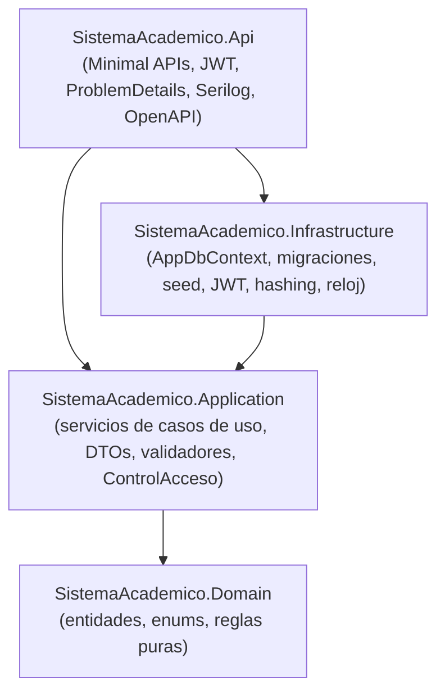
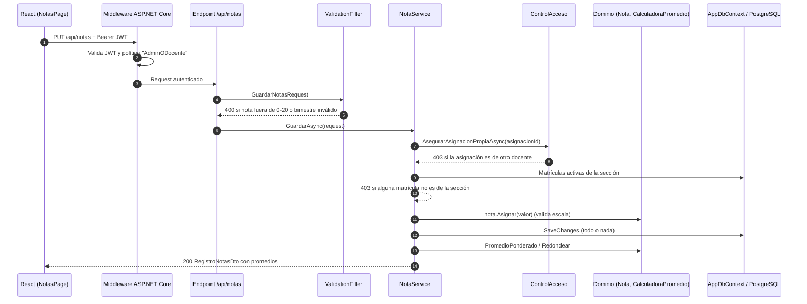
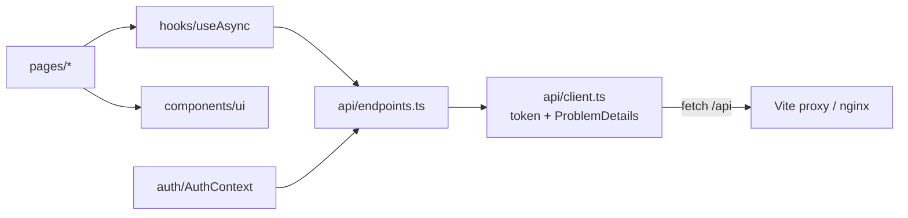

# Arquitectura

El backend sigue **Clean Architecture**: cuatro proyectos con dependencias que apuntan hacia el núcleo del negocio. El frontend es una SPA que consume la API a través de un proxy (Vite en desarrollo, nginx en Docker).

## Capas del backend

| Proyecto | Responsabilidad | Depende de |
|---|---|---|
| **Domain** | Entidades (`Alumno`, `Seccion`, `Nota`, `Cuota`…) y reglas sin I/O: `EscalaVigesimal`, `CalculadoraPromedio`, `ReglasMatricula`, `CalculadoraMora`, `CronogramaPensiones`, `ResumenAsistencia`, `ReglasPromocion`. | Nada |
| **Application** | Casos de uso (`MatriculaService`, `NotaService`…), DTOs, validadores FluentValidation, paginación y **autorización por recurso** (`ControlAcceso`). Define puertos: `IAppDbContext`, `ICurrentUser`, `IClock`, `IPasswordHasher`, `ITokenService`. | Domain (+ abstracciones de EF Core) |
| **Infrastructure** | Implementa los puertos: EF Core (PostgreSQL/SQLite), configuraciones Fluent API, migraciones, `DbSeeder`, JWT, PBKDF2, reloj de Lima. | Application |
| **Api** | Composición (DI), autenticación/autorización, endpoints, filtro de validación, `GlobalExceptionHandler`, OpenAPI/Scalar, health checks. | Application, Infrastructure |

> ¿Por qué Application conoce `DbSet`? Ver [ADR 0002](decisiones/0002-dbcontext-como-puerto.md).

## Flujo de una petición

Ejemplo: un docente guarda notas con `PUT /api/notas`.

1. **Autenticación**: `JwtBearer` valida firma, emisor, audiencia y vigencia. Los claims `role`, `docente_id` y `apoderado_id` llegan sin mapear (`MapInboundClaims = false`).
2. **Autorización por rol** (grueso): políticas `Admin`, `AdminODocente`, `Autenticado` en cada grupo de endpoints.
3. **Validación de entrada**: `ValidationFilter<T>` ejecuta el validador FluentValidation del DTO.
4. **Autorización por recurso** (fino): `ControlAcceso` comprueba que la asignación, sección o matrícula pertenezca al usuario.
5. **Reglas de dominio**: las entidades y calculadoras lanzan `DomainException` si algo es inválido.
6. **Errores**: `GlobalExceptionHandler` traduce excepciones a ProblemDetails:

| Excepción | HTTP |
|---|---|
| `ValidationException` | 400 + `errors` por campo |
| `UnauthorizedException` | 401 |
| `ForbiddenException` | 403 |
| `NotFoundException` | 404 |
| `ConflictException`, `DbUpdateConcurrencyException` | 409 |
| `DomainException` | 422 |
| cualquier otra | 500 (sin detalles internos; se registra en el log) |

## Decisiones principales

- **Minimal APIs agrupadas por recurso** en lugar de controladores: menos código repetido y filtros por endpoint.
- **Servicios de aplicación** en lugar de MediatR: un proyecto de este tamaño no necesita un mediador; los servicios son explícitos y fáciles de seguir al aprender.
- **Proveedor de BD por configuración**: PostgreSQL en producción; SQLite para desarrollo rápido y pruebas sin Docker. Las migraciones son de Npgsql; con SQLite se usa `EnsureCreated`.
- **Reloj inyectable (`IClock`)**: la mora y el estado de las cuotas dependen de "hoy"; en pruebas se fija la fecha. La vigencia del JWT usa `TimeProvider` (hora real) porque es un tema de seguridad.
- **Enums como texto** en BD y JSON: datos legibles y contratos estables.
- **Logging estructurado**: Serilog escribe JSON compacto en consola; cada request queda registrado con método, ruta, estado y duración.
- **Autorización en el backend**: el menú del frontend se adapta al rol solo por comodidad; ver [ADR 0001](decisiones/0001-autorizacion-por-recurso.md).

## Frontend

- `api/client.ts` añade el token, convierte ProblemDetails en `ApiError` (con errores por campo) y dispara el cierre de sesión ante un 401.
- `AuthContext` revalida el token con `/api/auth/me` al recargar la página; nunca confía en datos del usuario guardados en el navegador.
- `RequireAuth` protege rutas por rol (comodidad de UX; la seguridad real está en la API).
- Las páginas se cargan con `React.lazy` (code splitting).
- La libreta usa variantes `print:` de Tailwind y `@page A4` para imprimirse limpia, incluso desde el modo oscuro.
