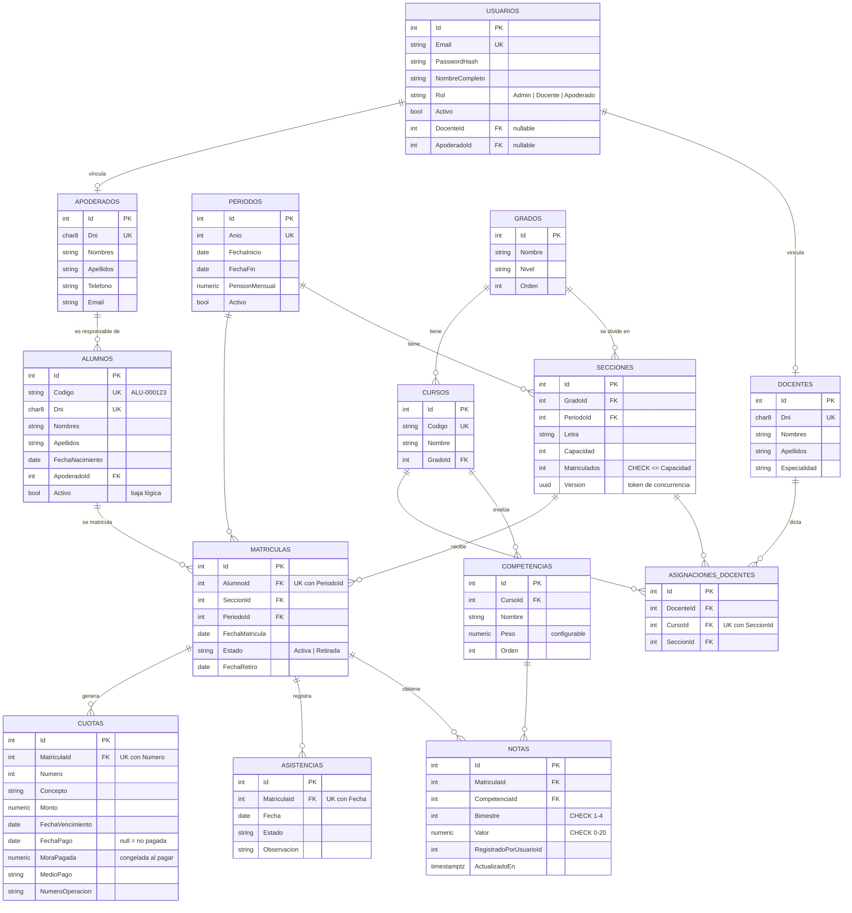

# Modelo de datos

Esquema relacional en PostgreSQL generado por la migración `Inicial` de EF Core (`backend/src/SistemaAcademico.Infrastructure/Persistence/Migrations`).

## Tablas

| Tabla | Propósito | Restricciones clave |
|---|---|---|
| `usuarios` | Cuentas de acceso. Un usuario docente/apoderado se vincula a su persona. | `Email` único. |
| `apoderados` | Padres o tutores responsables. | `Dni` único (8 dígitos). |
| `alumnos` | Estudiantes. Nunca se borran: baja lógica con `Activo`. | `Dni` y `Codigo` únicos; FK a apoderado con `RESTRICT`. |
| `docentes` | Plana docente. | `Dni` único. |
| `periodos` | Año escolar; define la pensión mensual. Solo uno activo. | `Anio` único. |
| `grados` | 1° Secundaria, 2° Secundaria… | — |
| `secciones` | Aula de un grado en un periodo, con capacidad. | Único (`GradoId`, `PeriodoId`, `Letra`); `CHECK Matriculados <= Capacidad`; `Version` como token de concurrencia. |
| `cursos` | Áreas curriculares por grado. | `Codigo` único. |
| `competencias` | Competencias evaluables de un curso con su **peso**. | Cascada al borrar el curso. |
| `asignaciones_docentes` | Docente que dicta un curso en una sección. Base de la autorización del docente. | Único (`CursoId`, `SeccionId`): un titular por curso y sección. |
| `matriculas` | Inscripción de un alumno en una sección para un periodo. | Único (`AlumnoId`, `PeriodoId`). |
| `notas` | Nota de una competencia en un bimestre. | Único (`MatriculaId`, `CompetenciaId`, `Bimestre`); `CHECK` 0-20 y bimestre 1-4. |
| `asistencias` | Asistencia diaria de una matrícula. | Único (`MatriculaId`, `Fecha`). |
| `cuotas` | Cronograma de pensiones de una matrícula. | Único (`MatriculaId`, `Numero`); índice por `FechaVencimiento`. |

## Notas de diseño

- **Dinero y notas con `numeric(p,s)`**: nunca `float`, para evitar errores de redondeo binario (0.1 + 0.2 ≠ 0.3). En SQLite (solo pruebas) se convierten a `REAL` porque SQLite no soporta agregados sobre decimal.
- **Estado de la cuota calculado**: solo se persiste `FechaPago`; "Vencida" o "Pendiente" dependen de la fecha de consulta. Así no hace falta un job nocturno que actualice estados.
- **`PeriodoId` redundante en `matriculas`**: permite el índice único que impide matricular dos veces a un alumno en el mismo año.
- **Restricciones en la BD además de en el código**: la validación de la aplicación da buenos mensajes; las restricciones de la BD son la última defensa ante condiciones de carrera o scripts manuales.
- **Nombres de tablas en snake_case** y columnas como las propiedades C# (convención por defecto de EF Core).
